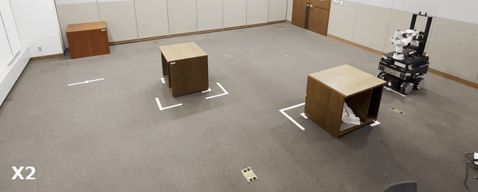

# Reconciling Safety and Performance via Dual-Expert Offline Imitation Learning (NeurIPS 2026)

> Safe navigation on a real mobile robot from human teleoperation demonstrations (Section 5.3)



**Demo.** A successful learning result of DexDICE in safe navigation.

This code contains the official implementation of **DexDICE** (**D**ual-**ex**pert offline imitation learning via **DICE**) for the real-robot mobile-navigation experiments, trained from teleoperation demonstrations on an omnidirectional (mecanum) mobile robot with a 360° LiDAR.

## Quickstart

```bash
# 1) install dependencies (jax[cuda13], flax, optax, ...) into ./.venv
uv sync

# 2) train DexDICE on the bundled teleoperation demonstrations
uv run python train_dexdice.py
```

## Installation

This project uses [uv](https://docs.astral.sh/uv/) for dependency management. Create the local environment:

```bash
uv sync
```

Key dependencies (Python ≥ 3.12, see `pyproject.toml`):

- `jax[cuda13]>=0.10.0`
- `flax>=0.12.7`
- `optax>=0.2.8`
- `numpy>=2.4.4`
- `matplotlib>=3.10.9`

## Teleoperation dataset

Demonstrations were collected via teleoperation on the real mobile robot and are pre-bundled under `teleoperation_data/`. No preprocessing step is required.

### Files and roles

- **`dataset_aggressive.pkl`**: performant (high-return) teleoperated demos — `D_P`
- **`dataset_safe.pkl`**: safety-compliant demos — `D_S`
- **`dataset_unlabeled.pkl`**: unlabeled extraction dataset — `D_U`
- **`layout.json`**: fixed evaluation-environment layout (initial pose / goal / obstacles)

### State / action specification

```
state  = [vx, vy, wz,                      # body-frame velocity                  (3-d)
          dx_body, dy_body,                # goal position relative to robot      (2-d)
          cos(dyaw), sin(dyaw)]            # goal yaw  relative to robot          (2-d)

scan   = (370,) LiDAR ranges in [0, 30] m  # /30 normalized, sparse top-K beams used
action = (vx_cmd, vy_cmd, wz_cmd)          # body-frame cmd_vel
```

### Example dataset layout

```
teleoperation_data/
├── dataset_aggressive.pkl    # D_P
├── dataset_safe.pkl          # D_S
├── dataset_unlabeled.pkl     # D_U
└── layout.json               # fixed eval layout
```

## Training & evaluation

Training is single-script. The config block at the top of `train_dexdice.py` is the single source of truth:

```bash
uv run python train_dexdice.py
```

- Device selection is automatic (uses GPU through `jax[cuda13]` if available).
- Evaluation runs on the calibrated rollout environment (`mobile_env_2d.py`) at `EVAL_EVERY` steps and the best-scoring checkpoint is tracked.

### Config pointers (`train_dexdice.py`)

Key knobs you will typically edit:

| Knob              | Default  | Note                                                  |
|-------------------|----------|-------------------------------------------------------|
| `SCAN_MODE`       | `sparse` | `'none'` (state-only) or `'sparse'` (top-K beams)     |
| `N_SCAN_SPARSE_K` | `10`     | beams kept in sparse mode                             |
| `SEED`            | `0`      | RNG seed                                              |
| `TOTAL_STEPS`     | `1000000`| training iterations                                   |
| `DISC_QUANTILE`   | `0.2`    | DexDICE target FNR (κ) of the safe-support estimator  |
| `LAMBDA_INIT`     | `5.0`    | initial Lagrange multiplier                           |

### Example output layout

Outputs are written under `checkpoints/dexdice<auto-suffix>/`:

```
checkpoints/
└── dexdice<auto-suffix>/
    ├── policy_best.pkl
    ├── policy_step{N}.pkl
    ├── policy_final.pkl
    └── meta.json            # full config + eval_history
```

Per-eval lines on stdout: `step ...`, `[eval @ N] score=...`, `*NEW BEST*`.

## DexDICE in one paragraph

- `D_P` (aggressive): high-return demos → log density ratio `log r̂_P`
- `D_S` (safe): safety-compliant demos → support constraint `1{r̂_S > τ_κ}`
- `D_U` (unlabeled): extraction dataset (weighted BC)
- Advantage: `A = log r̂_P + λ · 1_safe + γ · ν(s′) − ν(s)`
- Closed-form optimal weight: `w* = exp(A − 1)` → weighted BC on `D_U`

## Repository structure (high-level)

- `train_dexdice.py`: training entrypoint (DexDICE on real-robot teleoperation data)
- `mobile_env_2d.py`: rollout-based evaluation environment (numpy)
- `teleoperation_data/`: bundled demonstrations (`D_P`, `D_S`, `D_U`) and fixed eval layout
- `pyproject.toml` / `uv.lock`: dependency specification (uv)
